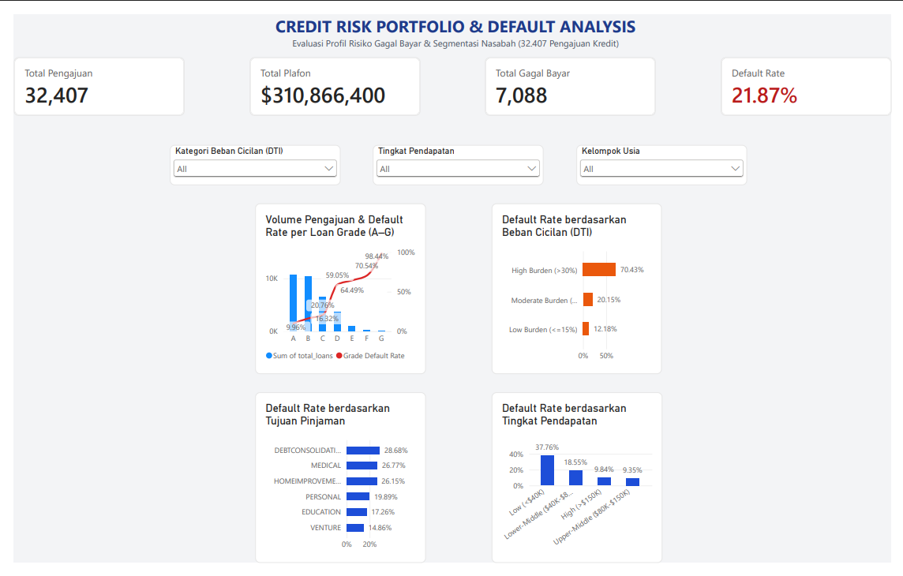

# Credit Risk Portfolio & Default Analysis (End-to-End Pipeline)

An end-to-end credit risk analysis project evaluating **32,407 loan applications** worth **$310.87M** to identify key drivers of borrower default and formulate actionable underwriting recommendations.

## 1. Business Problem & Objective
In consumer finance and lending operations, unchecked credit risk directly erodes portfolio profitability through Non-Performing Loans (NPL). This project aims to:
1. Clean and validate raw credit application records to ensure data integrity.
2. Build a structured relational storage and analytical aggregation layer in **MySQL**.
3. Identify high-risk borrower segments across **Debt-to-Income (DTI) burden**, **Loan Grade**, **Loan Intent**, and **Income Tiers** through an interactive **Power BI** executive dashboard.

## 2. Data Pipeline & Tech Stack
* **Data Cleaning & Feature Engineering (Python / Google Colab):** Handled delimiter inconsistencies, removed duplicate records (`32,581` $\rightarrow$ `32,407` valid rows), filtered logical anomalies (`person_age > 100` and `person_emp_length > person_age`), imputed missing values using median, and engineered business segmentation columns (`age_group`, `income_tier`, `dti_category`, `loan_status_label`).
* **Database Modeling & Aggregation (MySQL):** Designed table schemas with indexing (`credit_risk`) and created pre-aggregated analytical `VIEW`s (`v_risk_by_grade`, `v_risk_segmentation`) to streamline reporting queries.
* **Business Intelligence & Visualization (Power BI Desktop):** Connected directly to MySQL via `Import` mode, built custom **DAX** measures (`Total Pengajuan`, `Total Plafon`, `Total Gagal Bayar`, `Default Rate`), and designed a 1-page interactive dashboard.

## 3. Key Analytical Findings
* **Portfolio Baseline:** Out of **32,407 loans** totaling **$310,866,400**, **7,088 borrowers defaulted**, resulting in an overall **Default Rate of 21.87%**.
* **Debt-to-Income (DTI) Threshold:** Default risk escalates sharply once debt burden exceeds 30% of annual income—jumping from **12.18%** (`Low Burden <= 15%`) and **20.15%** (`Moderate Burden 16%–30%`) to **70.43%** (`High Burden > 30%`).
* **Loan Grade Risk Escalation:** Default rates rise moderately from **Grade A (9.96%)** to **Grade C (20.76%)**, before surging dramatically across **Grade D (59.05%)**, **Grade E (64.49%)**, **Grade F (70.54%)**, and **Grade G (98.44%)**.
* **Loan Purpose & Income Vulnerability:** Loans intended for **Debt Consolidation (28.68%)**, **Medical (26.77%)**, and **Home Improvement (26.15%)** carry the highest default rates. Similarly, borrowers in the **Low Income (<$40K)** tier default at **37.76%**, nearly four times higher than **Upper-Middle ($80K–$150K)** borrowers (**9.35%**).

## 4. Actionable Credit Recommendations
1. **Enforce a Hard DTI Cap at 30%:** Require additional collateral, co-signers, or manual credit committee review for applications where `loan_percent_income` exceeds **30%** to curb the **70.43%** default concentration.
2. **Tighten Underwriting on Grades D–G:** Restrict maximum loan exposure and apply stricter income verification for **Grade D** applicants and below, where default probability exceeds **59%**.
3. **Targeted Risk Pricing & Screening for Debt Consolidation:** Implement stricter cash-flow checks on **Debt Consolidation** and **Low Income (<$40K)** segments to ensure borrowers are not taking new debt solely to cover existing obligations.

## 5. Repository Contents
* `notebooks/01_data_cleaning_segmentation.ipynb` — Python data cleaning and segmentation notebook.
* `sql/02_mysql_schema_and_views.sql` — MySQL DDL, analytical queries, and `CREATE VIEW` scripts.
* `Credit_Risk_Portfolio_Analysis.pbix` — Interactive Power BI Desktop source file.
* `Credit_Risk_Portfolio_Analysis.pdf` — Static PDF export of the final dashboard.